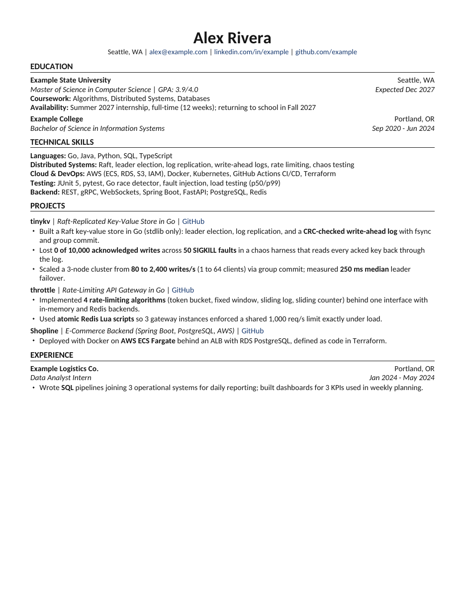

# jd-resume-tailor

A [Claude Code](https://claude.com/claude-code) skill (plus two small scripts) for tailoring a one-page resume to a specific job description **without making anything up**.

You keep every true bullet you have in one *bullet bank*. For each job, the skill reads the JD, picks and orders the bullets that match what that team builds, builds a one-page PDF, checks it, and helps you get the application form right.



<sub>Example output for a fictional candidate (`builder/example/resume.toml`, `infra` variant).</sub>

## Why

Sending one generic resume everywhere is the default, and it works badly: the project a database team cares about is buried under the one a product team cares about. Hand-editing a Word file per job is slow and drifts. The fix here is boring on purpose:

- **Bullet bank, not documents.** Write each true bullet once, with a key. A tailored resume is a 6-line *variant* that chooses skill groups and bullets.
- **Tailoring = choosing and ordering.** The skill is not allowed to add skills you have no evidence for, change numbers, or back-date anything. Gaps get reported to you as interview prep, not hidden in the PDF.
- **The form matters as much as the PDF.** ATS autofill quietly writes false statements into your application (project bullets pasted into a past job, the wrong field of study). The skill checks the review page before you sign the "everything is true" box.

## What's inside

| Path | What it does |
|---|---|
| `skill/jd-resume-tailor/SKILL.md` | The workflow Claude follows: fetch JD → hard constraints → map to bullet bank → build → visual check → neutral filename → form review → record |
| `skill/jd-resume-tailor/fetch_jd.py` | Gets the JD as text from a posting URL through each ATS's public JSON endpoint: Greenhouse, Ashby, Lever, Workday, Oracle Recruiting Cloud, SmartRecruiters. Follows referral/short links, reports if the posting is closed. Standard library only. |
| `skill/jd-resume-tailor/checklist.md` | Application form checklist: autofill damage, truthful answers, duplicates, application limits |
| `builder/build_resume.py` | One-page resume builder (ReportLab) driven by a TOML bullet bank. Fails on overflow, warns when a skills line wraps. |
| `builder/example/resume.toml` | A complete example bank with 3 variants (fictional person) |
| `config.example.md` | Template for your personal config (paths stay on your machine) |

## Quick start

```bash
git clone https://github.com/xungirl/jd-resume-tailor.git
cd jd-resume-tailor
./install.sh                     # links the skill into ~/.claude/skills/

# try the builder on the example
cd builder
uv run --with reportlab python build_resume.py example/resume.toml
# -> example/out/Alex_Rivera_Resume_{backend,infra,ai}.pdf

# try the JD fetcher
python3 ../skill/jd-resume-tailor/fetch_jd.py "https://job-boards.greenhouse.io/<company>/jobs/<id>"
```

Then copy `builder/example/resume.toml` somewhere private, replace it with your own facts, and copy `config.example.md` to `~/.config/jd-resume-tailor/config.md` with your paths. In Claude Code, paste a job link and say *"tailor my resume for this"*.

Requirements: Python 3.11+, `reportlab` (the example uses [uv](https://docs.astral.sh/uv/) to pull it in), optionally `pdftoppm` (poppler) so Claude can look at the rendered page. For nicer typography put the Carlito fonts (SIL OFL, metric-compatible with Calibri) in a folder and set `FONT_DIR`.

Already have your own resume script? Keep it. Point the config at it; the skill only needs to know how to add a variant and run a build.

## How a tailoring run goes

1. `fetch_jd.py` → title, location, **OPEN/closed**, JD text.
2. Hard constraints first: graduation window, semesters left, program dates, onsite city, sponsorship wording, "max 2 applications per cycle". Conflicts are reported plainly.
3. One sentence for *what this team builds*; the project that best proves it leads. Languages line is reordered for the JD; off-topic projects are dropped.
4. New variant → build → `OVERFLOW` is a failure, spare room gets the next true bullet → render PNG and look at it.
5. Copy to `submit_<variant>/First_Last_Resume.pdf` so one company's name never reaches another company's recruiter.
6. Paste the form's review page and the skill checks it against `checklist.md`.

## Tested

`fetch_jd.py` was checked against live internship postings on all six supported ATSs (including a Greenhouse `token=` embed link that doesn't name the company, and a closed posting returning exit code 2).

## License

MIT

---

## 中文说明

一个 Claude Code skill，再加两个小脚本，用来**按岗位 JD 微调一页简历，而且不编造任何东西**。

**思路：**
- **素材库，而不是文档。** 每条真实的 bullet 只写一次，给它起个 key。针对一个岗位的简历，就是一个只有 6 行的「版本」，挑选用哪些技能组、哪些 bullet，按什么顺序排。
- **微调 = 挑选 + 排序。** 不许加没有证据的技能，不许改数字，不许倒填日期。JD 要求而你没有的东西，作为「面试要准备的短板」告诉你，不会偷偷写进简历。
- **申请表和简历一样重要。** Workday 这类系统会自动解析简历，经常把项目经历塞进实习描述、选错本科专业。勾「以上信息真实」之前，让 Claude 按 checklist 查一遍。

**流程：** 抓 JD（6 种招聘系统的公开接口，顺便判断岗位还开不开）→ 先看硬性条件（毕业时间、剩几个学期、实习日期、限投数量）→ 用一句话概括「这个组做什么」，最能证明这一点的项目放第一 → 生成新版本，超过一页算失败，有空位就补下一条真实的 bullet → 转成图片检查 → 复制一份文件名不带公司名的 → 检查申请表 → 记录投递。

**用法：** `./install.sh` 安装，把 `builder/example/resume.toml` 换成你自己的内容，在 Claude Code 里贴岗位链接，说「按这个 JD 改简历」。
