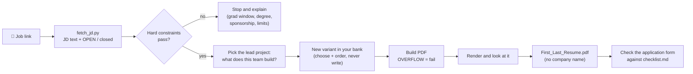

<h1 align="center">jd-resume-tailor</h1>

<p align="center">
  <b>Paste a job link. Get the best <i>honest</i> one-page resume you already have the facts for.</b>
</p>

<p align="center">
  
  
  
  
  
</p>

<table align="center">
  <tr>
    <td align="center" width="150"><br><b>Claude Code</b><br><sub>plugin</sub></td>
    <td align="center" width="150"><br><b>OpenAI Codex</b><br><sub>agent skill</sub></td>
    <td align="center" width="150"><br><b>DeepSeek Harness</b><br><sub>agent skill</sub></td>
  </tr>
</table>

<p align="center"><sub>Tested end to end on all three on 2026-11-20. See <a href="#tested">Tested</a>.</sub></p>

<br>

An agent skill that tailors your resume to each job description by **choosing and reordering your real bullets, never by inventing new ones**. It reads the JD straight from the applicant tracking system (ATS), checks the eligibility fine print, builds a one-page PDF, and then checks your application form for the false statements that autofill sneaks in.

<p align="center">
  
</p>
<p align="center"><sub>Same bullet bank, two job postings. The backend posting gets the API project first; the AI posting gets the retrieval-evaluation project first and an AI skills line on top. Fictional candidate, see <code>builder/example/resume.toml</code>.</sub></p>

---

## Contents

- [Quick start](#quick-start)
- [The rules](#the-rules)
- [How a run goes](#how-a-run-goes)
- [What it does for you](#what-it-does-for-you)
- [What's inside](#whats-inside)
- [Tested](#tested)
- [Why it works this way](#why-it-works-this-way)
- [中文说明](#中文说明)

## Quick start

###  Claude Code (recommended)

```
/plugin marketplace add xungirl/jd-resume-tailor
/plugin install jd-resume-tailor@jd-resume-tailor
```

Then say: *"tailor my resume for https://job-boards.greenhouse.io/acme/jobs/123"*

###  OpenAI Codex

```bash
npx skills add xungirl/jd-resume-tailor --agent codex     # installs to .agents/skills/
git clone https://github.com/xungirl/jd-resume-tailor.git  # for the resume builder
```

Then ask Codex to tailor your resume for a link. It picks the skill up on its own.

###  DeepSeek Harness

DeepSeek Harness (`dsh`) reads skills from `.agents/skills/` too, so the install is the same as for Codex. Put your key in `DEEPSEEK_API_KEY` or `$DSH_HOME/.env`, then:

```bash
dsh --profile headless "tailor my resume for <job link>"
```

### Other agents, or hacking on it

`npx skills add xungirl/jd-resume-tailor` installs the skill for any agent that [skills.sh](https://skills.sh) supports. It copies only the skill folder, so clone the repo for the builder.

```bash
git clone https://github.com/xungirl/jd-resume-tailor.git && cd jd-resume-tailor
./install.sh                                    # links the skill into ~/.claude/skills/

cd builder && uv run --with reportlab python build_resume.py example/resume.toml
# -> example/out/Alex_Rivera_Resume_{backend,infra,ai}.pdf

python3 ../skills/jd-resume-tailor/fetch_jd.py "https://job-boards.greenhouse.io/<company>/jobs/<id>"
```

> [!TIP]
> **Only have a PDF or Word resume?** Say so on the first run. The skill copies it into a bullet bank word for word (no polishing, no invented numbers), rebuilds your current resume from the bank so you can check nothing changed, and tailors from there.

> [!IMPORTANT]
> Keep your bullet bank **outside the plugin folder** (for example `~/resume/resume.toml`). Plugin updates replace that folder. Your paths go in `~/.config/jd-resume-tailor/config.md` (template: `config.example.md`), which never leaves your machine.

**Requirements:** Python 3.11+ and `reportlab` ([uv](https://docs.astral.sh/uv/) pulls it in). Optional: `pdftoppm` (poppler), so the agent can look at the rendered page. Fonts are embedded in the PDF: Arial on macOS/Windows, Liberation Sans on Linux, or Carlito if you set `FONT_DIR`. Already have your own resume script? Keep it, and point the config at it. The skill only needs to know how to add a variant and run a build.

## The rules

Most "AI resume" tools make you look better by writing things you didn't do. Recruiters and interviewers catch that, and the form you sign at the end says it's all true. This one is not allowed to:

| | Rule |
|:-:|---|
| 🚫 | **Write a bullet you don't have.** It only reuses bullets from your bank, or rewrites one with a fact it verified in your repo or benchmark file. |
| 🚫 | **Add a skill because the JD wants it.** A keyword you have no evidence for is reported to you as a gap to prepare for, not slipped into the PDF. |
| 🚫 | **Change numbers, dates, titles or degrees**, or back-date a project. |
| 🚫 | **Bend the truth on the form.** Sponsorship and work-authorization questions are answered truthfully, every time. |

## How a run goes



## What it does for you

| | |
|---|---|
| 🔎 **Reads the JD from the source** | Pulls the posting from Greenhouse, Ashby, Lever, Workday, Oracle Recruiting Cloud or SmartRecruiters through their public JSON endpoints. Follows referral and short links, and tells you the posting is closed before you spend 20 minutes on it. |
| ⚖️ **Catches the fine print** | Graduation windows, "two semesters remaining after the internship", fixed program dates, onsite-only, "at most 2 applications per cycle". Conflicts are flagged before you apply. |
| 🎯 **Leads with what the team builds** | One sentence on the team's actual work decides which project goes first. A storage team sees your write-ahead log; a product team sees your API design. |
| 📄 **Stays one page, and looks at it** | The builder fails on overflow and warns when a skills line wraps. The agent renders the PDF and checks it visually. |
| 🏷️ **Neutral filenames** | The upload copy is `First_Last_Resume.pdf`, so "Acme_Storage" never reaches a different company's recruiter. |
| 📝 **Checks the form** | Workday-style autofill pastes project bullets into a past job, picks the wrong field of study, leaves start dates blank. Paste the review page and it walks `checklist.md` before you hit Submit. |

## What's inside

| Path | What it does |
|---|---|
| `skills/jd-resume-tailor/SKILL.md` | The workflow the agent follows, from JD to form review |
| `skills/jd-resume-tailor/fetch_jd.py` | JD fetcher for 6 ATSs through their public JSON endpoints. Standard library only. |
| `skills/jd-resume-tailor/checklist.md` | Application form checklist: autofill damage, truthful answers, duplicates, limits |
| `builder/build_resume.py` | One-page ReportLab builder driven by a TOML bullet bank. Fails on overflow, warns on wrapped skill lines, embeds fonts. |
| `builder/example/resume.toml` | A complete example bank with 3 variants (fictional person) |
| `scripts/smoke_test.py` | Live check of all 6 ATSs, a closed posting, and the builder |
| `config.example.md` | Template for your personal config |
| `.claude-plugin/` | Plugin and marketplace manifests |

## Tested

Run the live check any time with `python3 scripts/smoke_test.py`. It finds an open posting on each of the six ATSs, fetches it, checks that a closed posting exits with code 2, and builds the example bank (3 PDFs, one page each, fonts embedded).

End-to-end runs on 2026-11-20. Each run installed the skill from GitHub into an empty setup, the way a new user would, and the skill was never named in the prompt.

| | Claude Code | OpenAI Codex | DeepSeek Harness |
|---|:-:|:-:|:-:|
| Version | plugin via `/plugin install` | Codex CLI 0.167.0 | dsh 0.2.2-alpha.3 |
| Picked up the skill on its own | ✅ | ✅ | ✅ |
| Fetched the JD | ✅ | ✅ | ✅ |
| PDF → bullet bank, original rebuilt with the same text | ✅ <sub>(one line break moved)</sub> | ✅ | ✅ |
| Tailored one-page PDF, fonts embedded | ✅ | ✅ | ✅ |
| Missing JD keywords reported as gaps, not added | ✅ | ✅ | ✅ |
| Stopped on a failed hard constraint | ✅ | not tested | not tested |

<details>
<summary><b>Details of each run</b></summary>

<br>

**Claude Code.** Installed with `/plugin marketplace add` + `/plugin install` into an empty Claude Code config, then driven with `claude -p --plugin-dir` with no user settings or other skills loaded. On a Staff posting (10+ years) and on an internship limited to third-year undergrads, it stopped before building and explained the failed constraint. Told to build anyway, it added exactly one variant to the bank, built a one-page PDF led by the matching Go project, listed GraphQL and React as gaps instead of adding them, and copied the PDF to a filename without the company. A second run started from a PDF only, built the bank, and rebuilt the original resume; the text matched except for one line break. These runs turned up two fixes, both shipped in 1.1.0: fonts weren't embedded (poppler drew bold as regular, so the visual check misreported), and the skill didn't say where the builder lives after a plugin install. Four runs cost about $1.20 in total.

**OpenAI Codex.** Installed with `npx skills add … --agent codex` into a fresh project, then `codex exec` with a resume PDF and an internship link. Codex found `.agents/skills/jd-resume-tailor/SKILL.md` and followed it end to end. The rebuilt original matched the source PDF's text exactly. It left the cloned repo untouched.

**DeepSeek Harness** (developer preview). Same install and prompt, run with `dsh --profile headless --permission-mode workspace-write --approval-policy never` and a separate `DSH_HOME`. Its first tool call loaded the skill through dsh's native `skill` tool. It built the bank (rebuilt text identical to the source), the tailored PDF and the upload copy, flagged the missing AI evidence as a gap without adding any, and left the cloned repo untouched.

**Note for testers:** the skill reads `~/.config/jd-resume-tailor/config.md` first. Point `HOME` at a scratch folder if you don't want an existing config read.

</details>

## Why it works this way

Sending one generic resume everywhere is the default, and it works badly: the project a database team cares about is buried under the one a product team cares about. Hand-editing a Word file per job is slow and drifts. The fix here is boring on purpose:

- **Bullet bank, not documents.** Write each true bullet once, with a key. A tailored resume is a 6-line *variant* that chooses skill groups and bullets.
- **Tailoring means choosing and ordering.** Gaps get reported to you as interview prep, not hidden in the PDF.
- **The form matters as much as the PDF.** ATS autofill quietly writes false statements into your application. The skill checks the review page before you tick the "everything is true" box.

## License

MIT. Claude Code, OpenAI Codex and DeepSeek logos are trademarks of their owners and are shown only to indicate compatibility. Logo files come from [LobeHub Icons](https://github.com/lobehub/lobe-icons) (MIT).

---

## 中文说明

<details>
<summary><b>点击展开</b></summary>

<br>

一个 agent skill，再加两个小脚本，用来**按岗位 JD 微调一页简历，而且不编造任何东西**。支持 **Claude Code、OpenAI Codex、DeepSeek Harness**，三个都在 2026-11-20 做过端到端实测。

**安装**

- **Claude Code（推荐）：** 先运行 `/plugin marketplace add xungirl/jd-resume-tailor`，再运行 `/plugin install jd-resume-tailor@jd-resume-tailor`。
- **OpenAI Codex / DeepSeek Harness：** 运行 `npx skills add xungirl/jd-resume-tailor --agent codex`，skill 会装进两者都会读的 `.agents/skills/`；再 `git clone` 本仓库，拿到生成简历用的 builder。DeepSeek Harness 的 key 放在 `DEEPSEEK_API_KEY` 或 `$DSH_HOME/.env` 里。
- 装好后贴一个岗位链接，说「按这个 JD 改简历」就行。

**只有 PDF 或 Word 简历？** 第一次用时说一声。skill 会把它逐字搬进素材库（不润色、不补数字），先还原出你现在这份简历让你核对，再开始微调。素材库要放在插件目录以外，因为插件更新会覆盖插件目录。

**规则：** 只用素材库里已有的 bullet；JD 要求而你没有的技能，列为「面试要准备的短板」，不会写进简历；不改数字、日期、职位、学位；申请表上 sponsorship 和工作许可的问题如实回答。

**流程：** 抓 JD（6 种招聘系统的公开接口，顺便判断岗位还开不开）→ 先看硬性条件（毕业时间、剩几个学期、实习日期、限投数量），不符合就停下来说明 → 用一句话概括「这个组做什么」，最能证明这一点的项目放第一 → 生成新版本，超过一页算失败 → 转成图片检查 → 复制一份文件名不带公司名的 → 检查申请表。

**测试：** `python3 scripts/smoke_test.py` 会在 6 种招聘系统上各抓一个在招岗位，检查已关闭的岗位返回 2，再用示例素材库生成 PDF。三个 agent 的端到端测试结果见上面的 [Tested](#tested) 表格。

</details>
