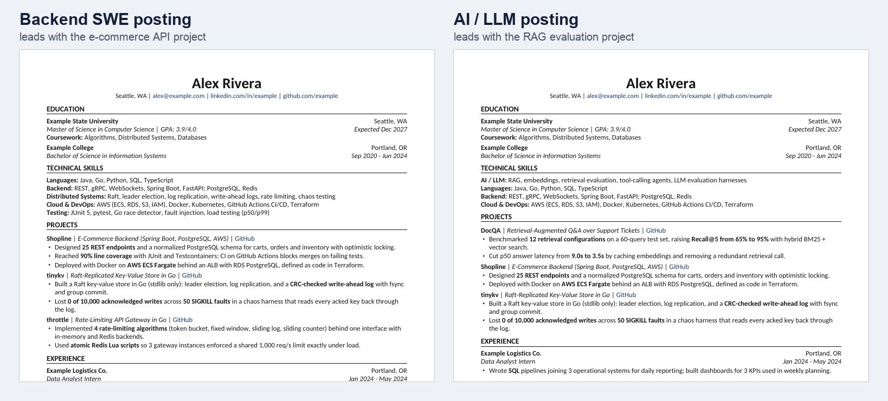
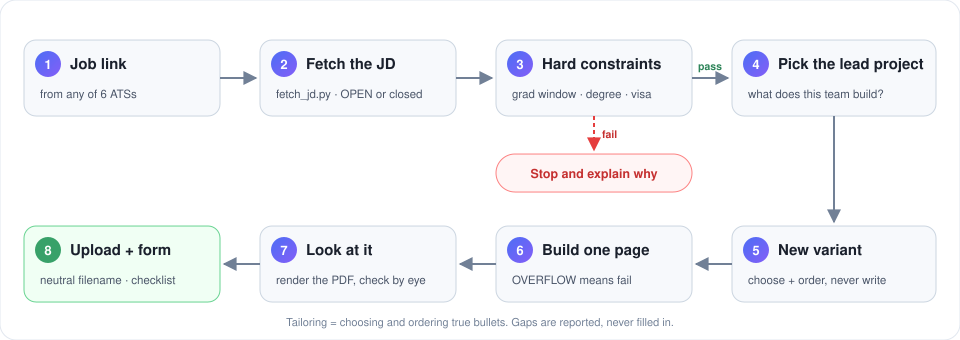

<h1 align="center">
  
</h1>

<p align="center">
  <b>Paste a job link. Get the best <i>honest</i> one-page resume you already have the facts for.</b>
</p>

<p align="center">
  
  
  
  
  
</p>

<table align="center">
  <tr>
    <td align="center" width="150"><br><b>Claude Code</b><br><sub>plugin</sub></td>
    <td align="center" width="150"><br><b>OpenAI Codex</b><br><sub>agent skill</sub></td>
    <td align="center" width="150"><br><b>DeepSeek Harness</b><br><sub>agent skill</sub></td>
  </tr>
</table>

<p align="center"><sub>Tested end to end on all three on 2026-11-20. See <a href="#tested">Tested</a>.</sub></p>

<br>

An agent skill that tailors your resume to each job description by **choosing and reordering your real bullets, never by inventing new ones**. It reads the JD straight from the applicant tracking system (ATS), checks the eligibility fine print, builds a one-page PDF, and then checks your application form for the false statements that autofill sneaks in.

<p align="center">
  
</p>
<p align="center"><sub>Same bullet bank, two job postings. The backend posting gets the API project first; the AI posting gets the retrieval-evaluation project first and an AI skills line on top. Fictional candidate, see <code>builder/example/resume.toml</code>.</sub></p>

---

## Contents

- [Install in one line](#install-in-one-line)
- [中文安装指南](#中文安装指南)
- [First run](#first-run)
- [The rules](#the-rules)
- [How a run goes](#how-a-run-goes)
- [What it does for you](#what-it-does-for-you)
- [What's inside](#whats-inside)
- [What it runs, reads and sends](#what-it-runs-reads-and-sends)
- [Tested](#tested)
- [Why it works this way](#why-it-works-this-way)
- [The app: browser extension with blind reviewers (beta)](#the-app-browser-extension-with-blind-reviewers-beta)

## Install in one line

You need one AI coding agent (Claude Code, OpenAI Codex or DeepSeek Harness) and Python 3.11 or newer. Open a terminal and paste **one** line.

####  Claude Code: install as a plugin

```bash
claude plugin marketplace add xungirl/jd-resume-tailor && claude plugin install jd-resume-tailor@jd-resume-tailor
```

Already inside Claude Code? Type `/plugin marketplace add xungirl/jd-resume-tailor`, then `/plugin install jd-resume-tailor@jd-resume-tailor`.

####   OpenAI Codex, DeepSeek Harness, or any agent

```bash
git clone https://github.com/xungirl/jd-resume-tailor ~/jd-resume-tailor && ~/jd-resume-tailor/install.sh
```

`install.sh` links the skill into `~/.claude/skills/` (Claude Code) and `~/.agents/skills/` (Codex and DeepSeek Harness read this folder), checks for Python and uv, and tells you in plain words what is missing. It installs no packages and writes no config. Use one way or the other for Claude Code, not both, or the skill shows up twice.

**Then restart your agent and say:**

> tailor my resume for https://job-boards.greenhouse.io/acme/jobs/123

For DeepSeek Harness, put your API key in `DEEPSEEK_API_KEY` (or in `~/.dsh/.env`) and run `dsh --profile headless "tailor my resume for <job link>"`, or use its web UI with `dsh web`.

<details>
<summary><b>New to this? What to install first</b></summary>

<br>

| You need | How to get it | Check it |
|---|---|---|
| One agent | [Claude Code](https://claude.com/claude-code) (paid Claude plan), [OpenAI Codex](https://developers.openai.com/codex) (ChatGPT plan), or [DeepSeek Harness](https://github.com/deepseek-ai/deepseek-harness) (pay-as-you-go DeepSeek API key) | `claude --version`, `codex --version` or `dsh --version` |
| Python 3.11+ | [python.org/downloads](https://www.python.org/downloads/), or `brew install python` on macOS | `python3 --version` |
| git | Comes with macOS developer tools (`xcode-select --install`) | `git --version` |
| uv (optional) | `curl -LsSf https://astral.sh/uv/install.sh \| sh`. Without it, run `python3 -m pip install reportlab` once. | `uv --version` |
| poppler (optional) | `brew install poppler`, so the agent can look at the rendered PDF | `pdftoppm -v` |

Tested on macOS. Linux should work the same way. Windows is not tested; use WSL.

</details>

<details>
<summary><b>Update, uninstall, other ways to install</b></summary>

<br>

| | Plugin (Claude Code) | `install.sh` |
|---|---|---|
| Update | `claude plugin marketplace update jd-resume-tailor && claude plugin update jd-resume-tailor@jd-resume-tailor` | `git -C ~/jd-resume-tailor pull` |
| Uninstall | `claude plugin uninstall jd-resume-tailor@jd-resume-tailor` | `~/jd-resume-tailor/install.sh --uninstall` |

Uninstalling never touches your bullet bank, your PDFs or `~/.config/jd-resume-tailor/`.

`install.sh --claude` links for Claude Code only, `install.sh --agents` for Codex and DeepSeek Harness only.

`npx skills add xungirl/jd-resume-tailor` ([skills.sh](https://skills.sh)) also works for many agents, but it copies only the skill folder, without the resume builder.

Hacking on it:

```bash
cd ~/jd-resume-tailor/builder && uv run --with reportlab python build_resume.py example/resume.toml
# -> example/out/Alex_Rivera_Resume_{backend,infra,ai}.pdf
python3 ~/jd-resume-tailor/skills/jd-resume-tailor/fetch_jd.py "https://job-boards.greenhouse.io/<company>/jobs/<id>"
python3 ~/jd-resume-tailor/scripts/smoke_test.py
```

</details>

## 中文安装指南

**它是什么：** 一个给 AI 编程助手用的「技能」。你贴一个岗位链接，它从你自己的真实经历里挑选、重新排序，生成一页英文简历 PDF。**不会编造任何经历、技能或数字。**

**1. 先准备两样东西**

- 一个 AI 编程助手，三选一：[Claude Code](https://claude.com/claude-code)（要 Claude 付费订阅）、[OpenAI Codex](https://developers.openai.com/codex)（要 ChatGPT 付费账号）、[DeepSeek Harness](https://github.com/deepseek-ai/deepseek-harness)（DeepSeek API 按量付费，跑一次很便宜）
- Python 3.11 或更新的版本。在终端输入 `python3 --version` 就能看到版本号；没有或者太旧的话，去 [python.org](https://www.python.org/downloads/) 下载，Mac 也可以用 `brew install python`

**2. 打开终端，复制一行，回车**

用 Claude Code 的：

```bash
claude plugin marketplace add xungirl/jd-resume-tailor && claude plugin install jd-resume-tailor@jd-resume-tailor
```

用 Codex、DeepSeek Harness 或其他助手的：

```bash
git clone https://github.com/xungirl/jd-resume-tailor ~/jd-resume-tailor && ~/jd-resume-tailor/install.sh
```

第二行会把技能装到各个助手都能找到的位置，并检查电脑上缺什么。缺东西会直接告诉你怎么装，不会偷偷替你装软件。Claude Code 用户两种方式选一种就行，都装的话技能会出现两次。

**3. 重启助手，说一句话**

> tailor my resume for 岗位链接

也可以说中文：「按这个 JD 改简历：岗位链接」。第一次用时它会问你两件事：**简历在哪**（PDF 或 Word 都可以，它会逐字整理成素材库，不润色、不补数字）和 **PDF 存到哪**。素材库请放在插件文件夹以外，比如 `~/resume/`。

DeepSeek Harness 需要先把 API key 写进 `DEEPSEEK_API_KEY` 环境变量（或者 `~/.dsh/.env` 文件），再运行 `dsh --profile headless "tailor my resume for 岗位链接"`，或者用 `dsh web` 打开网页界面。

**4. 更新和卸载**

- Claude Code：更新用 `claude plugin marketplace update jd-resume-tailor && claude plugin update jd-resume-tailor@jd-resume-tailor`，卸载用 `claude plugin uninstall jd-resume-tailor@jd-resume-tailor`
- 其他助手：更新用 `git -C ~/jd-resume-tailor pull`，卸载用 `~/jd-resume-tailor/install.sh --uninstall`
- 卸载不会删你的素材库、PDF 和配置文件

**常见问题**

| 问题 | 回答 |
|---|---|
| 提示没有 uv？ | uv 不是必须的。可以按提示装 uv，也可以运行一次 `python3 -m pip install reportlab` |
| 能抓哪些网站的 JD？ | Greenhouse、Lever、Ashby、Workday、Oracle、SmartRecruiters。LinkedIn、Handshake 或公司自建的招聘页抓不了，把 JD 文字直接粘贴给它就行 |
| 适合什么简历？ | 美式英文一页简历（US Letter），适合找美国实习和工作 |
| Windows 能用吗？ | 只在 macOS 上测过，Windows 没测过，建议用 WSL |
| 简历内容会发给谁？ | 只发给你自己用的那个 AI 助手（Claude、OpenAI 或 DeepSeek）。插件本身不往别处发送任何东西，详见 [What it runs, reads and sends](#what-it-runs-reads-and-sends) |

## First run

Say *"tailor my resume for <job link>"*. The first time, the skill asks where your resume is and where PDFs should go, then saves those paths in `~/.config/jd-resume-tailor/config.md`, which never leaves your machine.

> [!TIP]
> **Only have a PDF or Word resume?** That's fine. The skill copies it into a bullet bank word for word (no polishing, no invented numbers), rebuilds your current resume from the bank so you can check nothing changed, and tailors from there.

> [!IMPORTANT]
> Keep your bullet bank **outside the plugin or clone folder** (for example `~/resume/resume.toml`). Plugin updates replace that folder.

Already have your own resume script? Keep it, and point the config at it (template: `config.example.md`). The skill only needs to know how to add a variant and run a build. Fonts are embedded in the PDF: Arial on macOS/Windows, Liberation Sans on Linux, or Carlito if you set `FONT_DIR`.

## The rules

Most "AI resume" tools make you look better by writing things you didn't do. Recruiters and interviewers catch that, and the form you sign at the end says it's all true. This one is not allowed to:

| | Rule |
|:-:|---|
| 🚫 | **Write a bullet you don't have.** It only reuses bullets from your bank, or rewrites one with a fact it verified in your repo or benchmark file. |
| 🚫 | **Add a skill because the JD wants it.** A keyword you have no evidence for is reported to you as a gap to prepare for, not slipped into the PDF. |
| 🚫 | **Change numbers, dates, titles or degrees**, or back-date a project. |
| 🚫 | **Bend the truth on the form.** Sponsorship and work-authorization questions are answered truthfully, every time. |

## How a run goes

<p align="center">
  
</p>

## What it does for you

<table>
  <tr>
    <td width="50%" valign="top">
      <h3>🔎 Reads the JD from the source</h3>
      Pulls the posting from Greenhouse, Ashby, Lever, Workday, Oracle Recruiting Cloud or SmartRecruiters through their public JSON endpoints. Follows referral and short links, and tells you the posting is closed before you spend 20 minutes on it.
    </td>
    <td width="50%" valign="top">
      <h3>⚖️ Catches the fine print</h3>
      Graduation windows, "two semesters remaining after the internship", fixed program dates, onsite-only, "at most 2 applications per cycle". Conflicts are flagged before you apply.
    </td>
  </tr>
  <tr>
    <td width="50%" valign="top">
      <h3>🎯 Leads with what the team builds</h3>
      One sentence on the team's actual work decides which project goes first. A storage team sees your write-ahead log; a product team sees your API design.
    </td>
    <td width="50%" valign="top">
      <h3>📄 Stays one page, and looks at it</h3>
      The builder fails on overflow and warns when a skills line wraps. The agent renders the PDF and checks it by eye.
    </td>
  </tr>
  <tr>
    <td width="50%" valign="top">
      <h3>🏷️ Neutral filenames</h3>
      The upload copy is <code>First_Last_Resume.pdf</code>, so "Acme_Storage" never reaches a different company's recruiter.
    </td>
    <td width="50%" valign="top">
      <h3>📝 Checks the form</h3>
      Workday-style autofill pastes project bullets into a past job, picks the wrong field of study, leaves start dates blank. Paste the review page and it walks <code>checklist.md</code> before you hit Submit.
    </td>
  </tr>
</table>

## What's inside

```
jd-resume-tailor/
├── skills/jd-resume-tailor/
│   ├── SKILL.md            the workflow the agent follows, from JD to form review
│   ├── fetch_jd.py         JD fetcher for 6 ATSs (public JSON endpoints, stdlib only)
│   └── checklist.md        application form checklist: autofill damage, truthful answers
├── builder/
│   ├── build_resume.py     one-page builder: fails on overflow, embeds fonts
│   └── example/resume.toml example bullet bank with 3 variants (fictional person)
├── scripts/smoke_test.py   live check of all 6 ATSs, a closed posting, and the builder
├── install.sh              one-line installer: links the skill for Claude Code, Codex, DeepSeek Harness
├── config.example.md       template for your personal config
└── .claude-plugin/         plugin and marketplace manifests
```

## What it runs, reads and sends

Everything happens on your machine. There are no hooks, no MCP servers, no telemetry, and it never changes your agent's permission settings.

| | |
|---|---|
| **Runs** | `python3 fetch_jd.py` (standard library only); the builder via `uv run --with reportlab` (or your own build script, if your config names one); optionally `pdftoppm` / `pdffonts` / `sips` to look at the PDF |
| **Network** | `fetch_jd.py` requests only the posting URL you give it (following its redirects, e.g. referral or short links) and that ATS's public posting API: `boards-api.greenhouse.io`, `api.lever.co`, `api.ashbyhq.com`, `api.smartrecruiters.com`, the company's `*.myworkdayjobs.com` tenant, or its `*.oraclecloud.com` host. `uv` downloads `reportlab` from PyPI the first time. Nothing else is fetched, and nothing about you is sent anywhere. |
| **Reads** | Your bullet bank, `~/.config/jd-resume-tailor/config.md`, the resume PDF or DOCX you point it to, and the repo or benchmark files you name when it verifies a fact |
| **Writes** | One new variant block in your bank (after a backup), PDFs in your output folder, the config file on first run, and a tracker row only if your config names a tracker |

Your resume content goes to whatever model your agent uses, as with anything else you ask that agent to do.

## Tested

Run the live check any time with `python3 scripts/smoke_test.py`. It finds an open posting on each of the six ATSs, fetches it, checks that a closed posting exits with code 2, and builds the example bank (3 PDFs, one page each, fonts embedded).

End-to-end runs on 2026-11-20. Each run installed the skill from GitHub into an empty setup, the way a new user would, and the skill was never named in the prompt.

| | Claude Code | OpenAI Codex | DeepSeek Harness |
|---|:-:|:-:|:-:|
| Version | plugin via `/plugin install` | Codex CLI 0.167.0 | dsh 0.2.2-alpha.3 |
| Picked up the skill on its own | ✅ | ✅ | ✅ |
| Fetched the JD | ✅ | ✅ | ✅ |
| PDF → bullet bank, original rebuilt with the same text | ✅ <sub>(one line break moved)</sub> | ✅ | ✅ |
| Tailored one-page PDF, fonts embedded | ✅ | ✅ | ✅ |
| Missing JD keywords reported as gaps, not added | ✅ | ✅ | ✅ |
| Stopped on a failed hard constraint | ✅ | not tested | not tested |

<details>
<summary><b>Details of each run</b></summary>

<br>

**Claude Code.** Installed with `/plugin marketplace add` + `/plugin install` into an empty Claude Code config, then driven with `claude -p --plugin-dir` with no user settings or other skills loaded. On a Staff posting (10+ years) and on an internship limited to third-year undergrads, it stopped before building and explained the failed constraint. Told to build anyway, it added exactly one variant to the bank, built a one-page PDF led by the matching Go project, listed GraphQL and React as gaps instead of adding them, and copied the PDF to a filename without the company. A second run started from a PDF only, built the bank, and rebuilt the original resume; the text matched except for one line break. These runs turned up two fixes, both shipped in 1.1.0: fonts weren't embedded (poppler drew bold as regular, so the visual check misreported), and the skill didn't say where the builder lives after a plugin install. Four runs cost about $1.20 in total.

**OpenAI Codex.** Installed with `npx skills add … --agent codex` into a fresh project, then `codex exec` with a resume PDF and an internship link. Codex found `.agents/skills/jd-resume-tailor/SKILL.md` and followed it end to end. The rebuilt original matched the source PDF's text exactly. It left the cloned repo untouched.

**DeepSeek Harness** (developer preview). Same install and prompt, run with `dsh --profile headless --permission-mode workspace-write --approval-policy never` and a separate `DSH_HOME`. Its first tool call loaded the skill through dsh's native `skill` tool. It built the bank (rebuilt text identical to the source), the tailored PDF and the upload copy, flagged the missing AI evidence as a gap without adding any, and left the cloned repo untouched.

**One-line install** (`install.sh`, 2026-11-20). Both one-liners were run from GitHub in clean environments: the Claude Code line in an empty Claude config, and the `git clone … && install.sh` line in a fresh `HOME`, followed by a Codex run that found the skill through `~/.agents/skills` with no other setup. That run turned up two rule gaps, fixed in SKILL.md: Codex added a work-authorization line the user had only mentioned in chat, and copied and edited the builder to fix a widow. A second run from a fresh clone, with the fixed rules, added no word that wasn't in the source resume and used the builder in place.

**Note for testers:** the skill reads `~/.config/jd-resume-tailor/config.md` first. Point `HOME` at a scratch folder if you don't want an existing config read.

</details>

## Why it works this way

Sending one generic resume everywhere is the default, and it works badly: the project a database team cares about is buried under the one a product team cares about. Hand-editing a Word file per job is slow and drifts. The fix here is boring on purpose:

- **Bullet bank, not documents.** Write each true bullet once, with a key. A tailored resume is a 6-line *variant* that chooses skill groups and bullets.
- **Tailoring means choosing and ordering.** Gaps get reported to you as interview prep, not hidden in the PDF.
- **The form matters as much as the PDF.** ATS autofill quietly writes false statements into your application. The skill checks the review page before you tick the "everything is true" box.

## The app: browser extension with blind reviewers (beta)

[`app/`](app/) puts this skill behind a button.
- **The flow.**
  1. On any job page, click **Capture JD**, then **Tailor my resume**.
  2. The AI agent already on your computer writes the resume with this skill: Claude Code, Codex, Grok Build, or DeepSeek inside Claude Code.
  3. Script checks measure the page.
  4. A hiring-manager reviewer and an ATS reviewer, each in a folder holding only the JD and the PDF, review it before you see it. Then comes a revision and a gate.
- **No account, no server, no token.** The extension reaches your computer through Chrome's native messaging, registered once with `app/install.sh`.
- **Safe with your bank.** Your bullet bank is backed up before every run, and you can undo the run's changes in one click.
- **Your repos too.** It can mine your project repos for projects that aren't on your resume yet, using only facts found in their files.

See [app/README.md](app/README.md).

## License

MIT. Claude Code, OpenAI Codex and DeepSeek logos are trademarks of their owners and are shown only to indicate compatibility. Logo files come from [LobeHub Icons](https://github.com/lobehub/lobe-icons) (MIT). The title is set in [Unbounded](https://github.com/googlefonts/unbounded) (SIL OFL 1.1), outlined by `docs/make_wordmark.py`.
